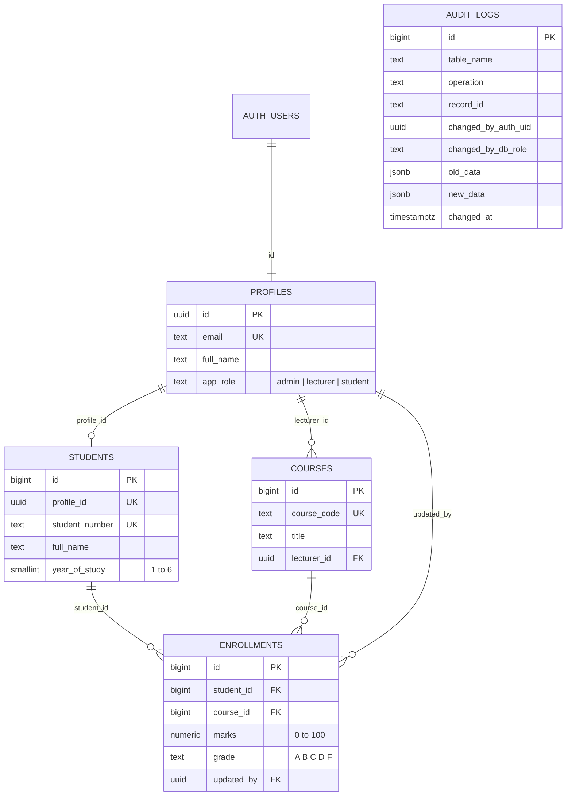

# Database Design: Secure Student Records Management System

**Course:** BIT3360 Advanced Databases
**Implements:** `database/01_schema.sql` (Block 1)
**Platform:** Supabase-hosted PostgreSQL
**Data:** synthetic only, in a project created for this assignment

## 1. Overview

The database has five tables in the `public` schema, one unexposed `private` schema for security helper functions, and (added later in `04_roles_and_grants.sql`) a `demo` schema for the standalone SQL-role demonstration.

Credentials never live in `public`. Supabase Auth stores password hashes in `auth.users`, and `public.profiles` links each login to an application role.

## 2. Entity Relationship Diagram

`audit_logs` has no relationships by design (see 5.1).

## 3. Tables

| Table | Purpose | Key constraints |
|---|---|---|
| `profiles` | Maps `auth.uid()` to the business role | PK `id` references `auth.users(id)` `ON DELETE CASCADE`; `email` unique; `app_role` default `'student'` with a `CHECK` on the three valid roles |
| `students` | Student identity, separate from credentials | `profile_id` unique (one student per login); `student_number` unique; `year_of_study` `CHECK` 1 to 6 |
| `courses` | Courses and their owning lecturer | `course_code` unique; `lecturer_id` not null |
| `enrollments` | A student's place in a course, with protected marks | `UNIQUE (student_id, course_id)`; `marks` `CHECK` 0 to 100; `grade` `CHECK` in A, B, C, D, F |
| `audit_logs` | Append-only history of data changes | `operation` `CHECK` in INSERT, UPDATE, DELETE |

## 4. Delete Behaviour

| Relationship | Rule | Reason |
|---|---|---|
| `profiles.id` to `auth.users` | `CASCADE` | Removing a login removes its profile |
| `students.profile_id` to `profiles` | `RESTRICT` | Deleting a login must not silently delete a student record; the admin removes the student first |
| `courses.lecturer_id` to `profiles` | `RESTRICT` | A course cannot be left without a lecturer |
| `enrollments.student_id` to `students` | `CASCADE` | An admin can delete a student (TC-08); their enrolments go with them and each deletion is audit-logged |
| `enrollments.course_id` to `courses` | `RESTRICT` | A course with enrolments cannot be deleted by accident |
| `enrollments.updated_by` to `profiles` | `SET NULL` | History survives if the editing user is removed |
| `audit_logs` | no foreign keys | The log must outlive every record it describes |

## 5. Design Decisions

### 5.1 Why `audit_logs` is decoupled

If the log referenced `students` or `enrollments`, deleting a student would either fail or erase their history. With no foreign keys, `record_id` is stored as `text`, which also lets it hold the UUID ids of `profiles`.

### 5.2 Why helper functions live in `private`

RLS policies that query the table they protect, or two tables that query each other, cause infinite recursion (error 42P17). The four helpers read tables as `SECURITY DEFINER`, so those reads skip RLS:

| Function | Returns | Used by policies for |
|---|---|---|
| `private.current_app_role()` | the caller's `app_role` | admin-only operations; reading profiles |
| `private.my_student_id()` | the caller's `students.id` | a student seeing only their own enrolments |
| `private.is_my_course(course_id)` | boolean | a lecturer seeing and marking only their own courses |
| `private.is_student_in_my_course(student_id)` | boolean | a lecturer seeing students enrolled in their courses |

Each has `search_path = ''` (so no object can be hijacked through the search path) and `EXECUTE` limited to `authenticated`. The `private` schema is not exposed through the Data API.

### 5.3 Why the signup trigger hard-codes `'student'`

Users can edit their own `user_metadata`, so reading a role from it would let anyone make themselves an admin. New accounts are always students; the database owner promotes the admin and lecturers with a manual `UPDATE` (done in `05_seed_data.sql`).

### 5.4 Indexes

| Index | Supports |
|---|---|
| `courses (lecturer_id)` | lecturer course-ownership checks |
| `enrollments (course_id)` | course joins and lecturer checks |
| `audit_logs (changed_at desc)` | newest-first audit view |
| `audit_logs (table_name, record_id)` | finding the history of one record |
| `students.profile_id` | already indexed by its `UNIQUE` constraint |
| `enrollments.student_id` | already covered by `UNIQUE (student_id, course_id)` |

### 5.5 Safe by default

The script runs `ALTER DEFAULT PRIVILEGES ... REVOKE` before creating any table, enables RLS on all five tables, and revokes every privilege from `PUBLIC`, `anon` and `authenticated`. Until `02_rls_and_grants.sql` runs, the API can read nothing. This closes the window in which Supabase's default grants would expose the new tables.

## 6. How to Run

1. Create the Supabase project (assignment use only).
2. Open **SQL Editor**, paste `database/01_schema.sql` and run it.
3. Run the four verification queries at the bottom of the script and record the results below.
4. Continue with `02_rls_and_grants.sql`, `03_audit_trigger.sql`, `05_seed_data.sql`, then `04_roles_and_grants.sql`.

**Seed order:** create the Auth users in the Dashboard first (Authentication > Users). The signup trigger creates their `profiles` rows as `student`. Then promote the admin and lecturers, then insert students, courses and enrolments using the real user UUIDs.

## 7. Verification Record

Fill in after running `01_schema.sql` on the live project.

| Check | Expected | Observed | Date / by |
|---|---|---|---|
| V1: RLS enabled on 5 tables | all `true` | | |
| V2: API role grants on `public` | 0 rows | | |
| V3: `anon` can execute helper | `false` | | |
| V3: `authenticated` can execute helper | `true` | | |
| V4: `on_auth_user_created` exists | 1 row | | |

## 8. Known Limitations

- A `lecturer_id` is not checked at the database level to belong to a user whose `app_role` is `lecturer`. Only the admin can create courses, so this is enforced by policy; a stricter version would add a check trigger.
- Marks and grades are validated for range only, not for business rules such as moderation or resits.
- The `demo` schema (Block 4) is intentionally outside this design, so that the classic `GRANT`/`REVOKE` demonstration is not distorted by RLS.
